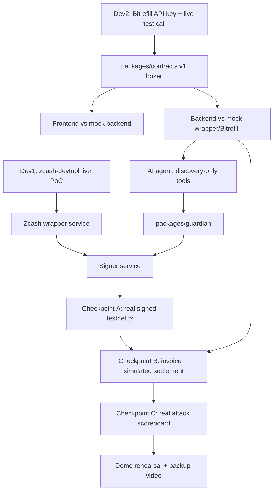

# Development Roadmap

Status: **Fully replaced 2026-11-04.** The hackathon runs **November 4–5, 2026 — today and tomorrow.** The prior 10–12 day plan is moved to Plan B (post-hackathon) in full. Plan A below is the actual implementation sequence. **Never blend features between the two plans when describing what the demo can show.**

---

## Plan A — Hackathon MVP (today/tomorrow)

### Hour 0 — before any feature code (both developers, parallel, ~1–2 hours)

- **Dev 1**: live PoC — install `zcash-devtool`, connect to `testnet.zec.rocks:443`, create a wallet, get a `utest1...` address, claim TAZ from the `valargroup` faucet, confirm a balance appears. Then attempt one `send` between two local test wallets and confirm seen→mined→confirmed. **This determines whether the whole Zcash leg is real or needs the `Thus Spoke Zakura` local fallback instead** — decide and document the result in `zcash-integration.md` before building further.
- **Dev 2**: scaffold `packages/contracts` v1 (mandate, order with the 17-state machine, product, guardian request/response, receipt), SQLite schema (mandates, orders, consumed_nonces, payment_intents). Get a real Bitrefill Personal API key, make one real `search-products` and `get-product-details` call to confirm the shape documented in `bitrefill-integration.md`.
- **Shared**: once both PoCs land, freeze `packages/contracts` v1 — additive-only from here.

### Hours 2–6 — parallel build

- **Dev 1**: build the Node wrapper service around `zcash-devtool` (wallet create, address, balance, send, sync/confirmation status); build the funding and dashboard UI against the mock backend.
- **Dev 2**: build the guardian (pure, unit-tested, no live dependency) and mandate engine; build the AI agent's tool harness registered with **only** `search-products`/`get-product-details` (`bitrefill-integration.md` §2).

### Hours 6–9 — first real integration

- **Dev 2**: build the signer process; wire it to Dev 1's real `zcash-devtool` wrapper.
- **Checkpoint A**: one real, guardian-approved order produces a real signed, broadcast, confirmed testnet transaction from a mandate's envelope wallet. This is the single most important checkpoint — everything else can be simulated if time runs out, this cannot.
- **Dev 1**: wire the real funding flow (user wallet → envelope wallet) end-to-end in the UI.

### Hours 9–12 — commerce leg + simulated settlement

- **Dev 2**: wire `buy-products` invoice creation (real), and the explicitly-labeled simulated-settlement step (`payment-flow.md` §2).
- **Checkpoint B**: full flow — prompt → agent search → guardian approval → real signed Zcash tx → real Bitrefill invoice created → simulated settlement banner shown → receipt generated.

### Hours 12–16 — security demo + polish

- **Dev 2**: implement at minimum the highest-value attack scenarios from `testing-strategy.md` (prompt injection, price mismatch, budget overspend, nonce reuse, revoked mandate) — all 20 if time allows, but these 5 are the non-negotiable demo set.
- **Dev 1**: attack-scoreboard UI, receipt viewer with selective disclosure.
- **Checkpoint C**: scoreboard shows real pass/fail from an actual test run.

### Remaining time — demo rehearsal

- Run the full `demo-scope.md` script at least twice end-to-end. Record a backup video in case live testnet/faucet infra has trouble during judging.

### What is explicitly OUT of the hackathon MVP (do not attempt, do not imply)

- Real ZEC/TAZ-to-fiat-spendable-asset settlement (no provider supports testnet swaps — structurally impossible, not just hard).
- Per-mandate hardened sub-account derivation from a single seed (replaced by independent wallets, Option 2′).
- Multi-device/threshold signing, mobile signer, delegated sub-mandates (spec's own stated roadmap items).
- Full 20/20 attack-scenario automation if time doesn't allow — ship what's real and tested, never hardcode a pass.

---

## Plan B — Post-hackathon roadmap (not built now, documented for continuity)

- Production-grade key custody: revisit hardened ZIP-32 sub-account derivation once a verified SDK/library exposes it cleanly (zingolib is the strongest current candidate, pending a deeper integration spike than hackathon time allowed).
- Real commerce settlement: mainnet ZEC, a verified swap provider (re-verify SideShift's live shielded-ZEC support, or use a confirmed transparent-only alternative with disclosed limitations), real Bitrefill payment completion — **requires explicit user approval before ever touching real funds.**
- Signer-owned datastore unreachable by the ordinary backend API, closing the narrowed threat-model gap in `security-architecture.md` §3.
- Full 20-scenario attack automation, CI-integrated.
- Full receipt verification tooling (a standalone verifier CLI/page, independent of the OBSCURA backend).
- Operational monitoring, alerting, multi-user auth.

---

## Dependency graph (Plan A)

