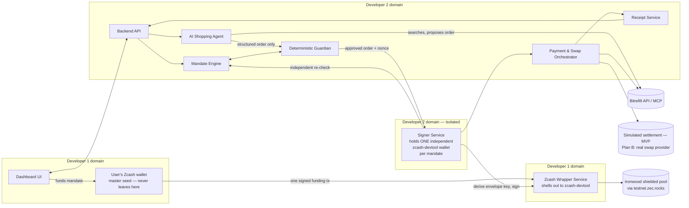

# OBSCURA — Architecture Overview

Status: **Proposed architecture, approved for documentation, not yet implemented.**
Last updated: 2026-11-04 (re-audited same day against the Free Society Hack / ZECATHON Zcash Developer Resources builder pack — see `verification-matrix.md` and `demo-scope.md`, both new in this revision).

**Hackathon context, confirmed:** this is being built for a hackathon on **November 4–5, 2026** — today and tomorrow. The roadmap in this folder reflects a 1-day MVP plan (`development-roadmap.md` Plan A), not the original 10–12 day plan (now Plan B, post-hackathon only).

## 1. What this document is

This is the entry point into the OBSCURA architecture. OBSCURA (formerly named VEIL — same project, name changed) is a privacy-preserving AI-agent commerce platform: a user gives an AI shopping agent a bounded, time-limited spending mandate backed by a small shielded Zcash balance, and a deterministic guardian + independent signer ensure the agent can never spend outside that mandate, even if the agent itself is fully compromised.

Read the other 11 documents in this folder for detail on each area. This file gives the one-page mental model.

## 2. Repository state as of this writing (confirmed, not assumed)

- Repo root is `C:\Users\khush\zcash` (git history preserved; see `team-work-allocation.md` for the git-hygiene notes).
- The repository was **empty of OBSCURA code** before this architecture pass — no prior frontend, backend, contracts, or docs existed for this project.
- No "VEIL Full Project Description.pdf" file exists anywhere searchable on this machine; the spec used for this architecture is the text the user pasted directly into this conversation on 2026-11-04.

## 3. Core principle

> "Give the agent a budget, not your keys."

The AI agent proposes. A deterministic guardian (plain code, no AI, no network calls to an LLM) checks every proposal against the user's mandate. An independent signer, which never shares a process or key material with the ordinary backend or the agent, re-validates and signs only the exact authorized transaction, once.

## 4. The three problems, and which component owns solving each

| Problem | Owning component | Mechanism |
|---|---|---|
| Surveillance | Zcash adapter + payment/swap service | Funds held in the Ironwood shielded pool at rest; fresh address per order; amount/timing variance at the swap step |
| Unbounded authority | Mandate engine + guardian + signer | Hard budget/category/merchant/expiry caps enforced twice, independently, outside the agent's reach |
| Prompt injection | AI agent harness + guardian | Untrusted product text is parsed into typed fields only; the guardian never reads free text, only structured, typed order fields |

## 5. One critical correction to the original spec

The spec (and common Zcash literature up to mid-2026) refers to the **Orchard shielded pool**. On 2026-07-28, a soundness bug in Orchard's proof circuit was found and the network upgrade "Ironwood" (NU6.3) **sealed the Orchard pool to withdrawals only** and opened a new pool, **Ironwood**, built on a patched version of the same circuit design. (Sources: [KuCoin](https://www.kucoin.com/news/flash/zcash-activates-ironwood-hard-fork-to-seal-orchard-pool-and-prevent-counterfeit-zec), [crypto-economy.com](https://crypto-economy.com/ironwood-goes-live-on-zcash/).)

**Decision (approved 2026-11-04): OBSCURA targets the Ironwood pool for all new shielded funds.** "Orchard" is used only when referring to the underlying circuit design/history. This is reflected throughout `zcash-integration.md` and must be reflected in the actual UI copy and code comments during implementation — do not let "Orchard" leak into user-facing text as the active pool name.

## 6. High-level architecture

## 7. What is confirmed fact vs. proposed design vs. open risk

- **Confirmed fact**: Bitrefill has a real self-serve Personal API and official MCP server (7 tools, not 18 — corrected in `bitrefill-integration.md`); Bitrefill does not accept ZEC directly; Zcash testnet is live with NU7/Ironwood active, a working faucet (`valargroup`), and a working public endpoint (`testnet.zec.rocks`); `zcash-devtool` is confirmed to support Ironwood; WebZjs, `@zcash/sdk`, Noir Wallet SDK, Zallet, zecd, and zcli/zecli are all confirmed **not** usable for NU7/Ironwood today.
- **Proposed design**: the module boundaries, the per-mandate independent-wallet isolation model (Option 2′), the signer isolation pattern, the receipt commitment scheme, the repo/ownership split, the transaction state machine.
- **Open risk, explicitly flagged, not hidden**: whether `zcash-devtool` can be reliably wrapped from Node within the remaining hackathon time (first task, live PoC required); a compromised backend process with database write access can still forge mandate state read by the signer (narrowed threat model, see `security-architecture.md` §3); no swap provider supports testnet TAZ, so the commerce settlement leg is **simulated and must be labeled as such** — see `demo-scope.md`.

See `threat-model.md` for what OBSCURA does **not** protect against, and `verification-matrix.md` for the full claim-by-claim verification ledger — both first-class parts of the architecture, not footnotes.
