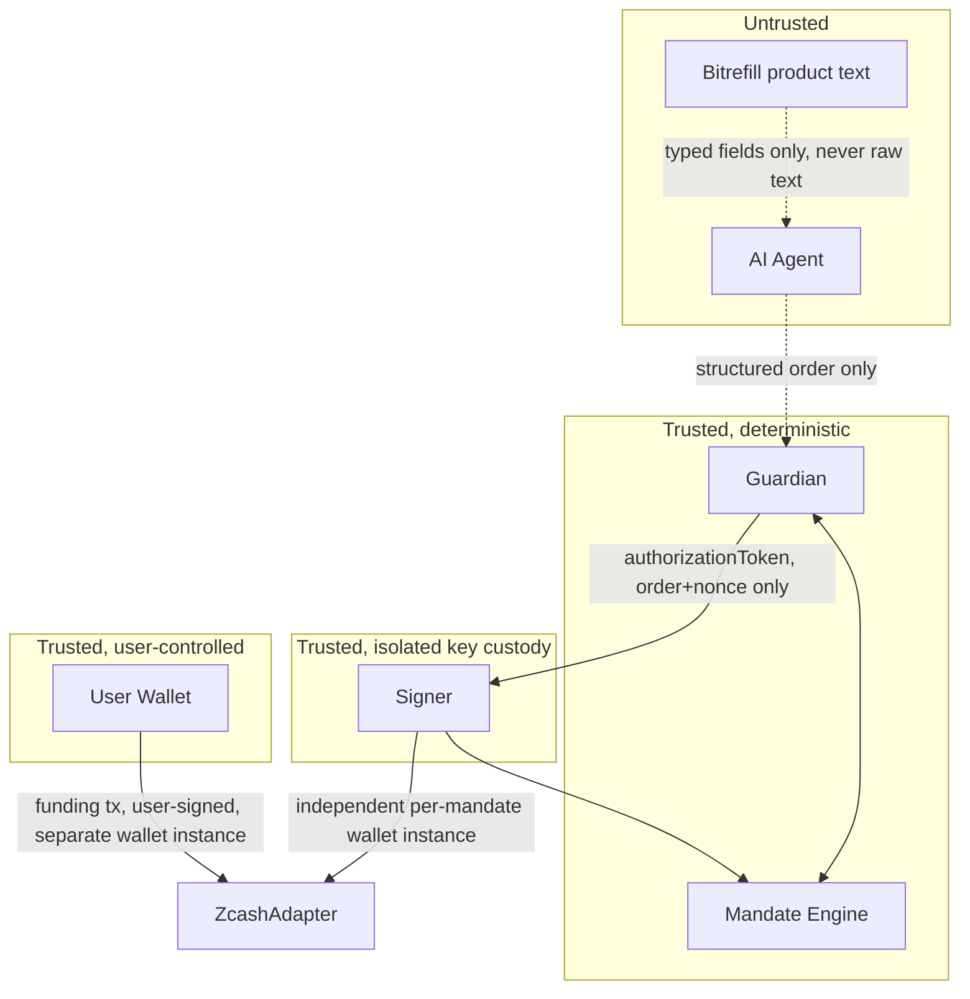

# Security Architecture

## 1. Mapping the 17 non-negotiable principles to enforcement points

| # | Principle | Enforced by | How |
|---|---|---|---|
| 1 | Agent never gets private keys | Process isolation | Agent runs inside the backend API process/sandbox; the signer is a separate OS process the agent has no network path to |
| 2 | Agent never authorizes payments | Guardian + signer | Agent output type is `ProposedOrder`, which has no "authorize" capability in its schema |
| 3 | Frontend never determines financial authorization | Guardian (backend-only) | Frontend only renders guardian/signer results, never computes them |
| 4 | Authorization is deterministic, AI-independent | Guardian | Plain TypeScript, zero LLM calls, unit-testable without network |
| 5 | Guardian validates every order | API routing | Every `/api/orders` write path is physically required to pass through `guardian.validate()` before touching the signer — enforced by code structure, not convention |
| 6 | Signer independently revalidates | Signer | Re-fetches mandate state itself; does not trust the guardian's token's claims beyond verifying its signature + expiry |
| 7 | Authorization bound to one order + nonce | Data model | `authorizationToken` embeds `orderId+nonce`; signer rejects any mismatch |
| 8 | Replay prevented | Signer + DB | Nonce marked consumed inside the same atomic transaction as signing — see §4 |
| 9 | Concurrent orders can't overspend | SQLite single-writer transaction | See §4 |
| 10 | Untrusted external data | Product/Order schema split | Free-text merchant fields never flow into `destination`/`amount`/`authorization` fields — only typed, re-verified fields do |
| 11 | External text can't override rules | Guardian | Guardian input type literally has no field for free text to occupy |
| 12 | Sensitive fields from trusted structured data only | Order schema | `priceMinor` is re-verified against a live Bitrefill lookup, never trusted from agent output alone |
| 13 | Fail closed | Guardian + signer | Any schema validation failure, any missing field, any ambiguous state → reject, never default-approve |
| 14 | Secrets never in frontend/LLM context/logs/git | See §5 | |
| 15 | Revocation prevents new authorizations | Mandate state machine | Guardian checks `status=="active"` on every call, not cached |
| 16 | Idempotent payment execution | `orderId` as idempotency key | Payment orchestrator keys all external calls (Bitrefill invoice creation; signer nonce-consumption) by `orderId` — no live swap-provider call exists in the MVP, see `demo-scope.md` |
| 17 | Honest privacy communication | `threat-model.md` | No "invisible to Bitrefill/swap provider" claims anywhere in docs or UI copy |

## 2. Key custody — revised design (Option 2′, post re-audit)

Status: **Revised 2026-11-04.** The hardened-ZIP-32-sub-account design is dropped — see `zcash-integration.md` §4 for the full reasoning. A hardened derivation path alone does not *prove* a key-provisioning mechanism exists in our chosen tooling, and none of the verified-working Zcash tools in this stack (`zcash-devtool`, zingolib) were confirmed to expose single-account spending-key export from a larger seed within the time available to check.

**Three key-material holders, never overlapping:**

1. User's main wallet (Developer 1 domain) — an independent `zcash-devtool` wallet instance, its own seed. Signs only mandate-funding transactions (sending TAZ to a new envelope wallet).
2. Signer service (Developer 2, isolated process `apps/signer/`) — holds **one independent `zcash-devtool` wallet instance per mandate** (its own seed, generated fresh at mandate-creation time — not derived from the user's seed). Executes order payments and sweep-back for that one mandate only.
3. Zcash wrapper service (shared library/process boundary used by both 1 and 2) — shells out to `zcash-devtool`; must not log wallet directory contents, seeds, or private keys.

**Verified fact, still true and still relevant**: Zcash's hardened-only account derivation (`m/32/coin_type/account`) is genuinely cryptographically independent between accounts — this remains a correct statement about the protocol. [Orchard Book](https://zcash.github.io/orchard/design/keys.html) It just isn't the mechanism OBSCURA uses for isolation now, because **independently-generated wallets provide the same isolation property without depending on any SDK's derivation-export feature actually working** — a strictly easier thing to prove.

**What this design proves, concretely:**
- No master seed enters the backend: true by construction (separate wallet instances/processes).
- No cross-mandate key exposure: true by construction (separate wallet instances).
- A compromised signer can spend at most one mandate's funded balance — a hard on-chain ceiling, not just an application-logic promise.

**What this design does NOT prove by itself** (and must not be claimed to): that the signer's *spending-limit logic* (per-order cap, category, merchant) is bug-free. That remains the guardian/signer's responsibility, unchanged from §3 below, and is exactly why the signer still independently re-validates every order against live mandate state rather than trusting the wallet's balance alone as a policy mechanism.

**First task for Developer 1 (see `development-roadmap.md`): verify `zcash-devtool` can be reliably driven from a Node wrapper (create wallet, get address, check balance, send, check confirmation) within the time available.** This is a live PoC requirement, not a research question — do not proceed past it on an assumed CLI output shape.

## 3. Why the signer must not trust the guardian

The signer is the last line of defense. If the guardian is buggy, bypassed, or its process is compromised, the signer must independently reconstruct the same verdict from the mandate's true state (budget, expiry, status, nonce-consumption) rather than trusting the guardian's `approved: true`. The `authorizationToken` is only used as a **transport binding** (proves the order and nonce the guardian saw match what reaches the signer) — its presence is necessary but never sufficient for the signer to sign.

**Honest limitation, stated explicitly (builder-pack requirement, not previously addressed):** the signer currently re-reads mandate state from the **same SQLite database** the ordinary backend API writes to. This means a fully compromised backend process — one with arbitrary write access to that database file — *could* rewrite a mandate's `totalCapMinor`, `status`, or `expiresAt` before the signer reads it, and the signer would faithfully honor the tampered values; re-reading from a source you don't also trust the writer of doesn't add protection on its own. **This is a real, narrowed threat-model boundary for the hackathon MVP**: OBSCURA's security model defends against a compromised **AI agent** and a compromised **ordinary API request path** (the agent or a malicious caller sending a forged order), but **does not** defend against an attacker with arbitrary write access to the backend's database file or process memory — that is treated as equivalent to full backend compromise, which is out of scope for a 1-day hackathon build (see `threat-model.md` for the explicit non-claims list). Plan B's mitigation is a signer-owned, backend-unreachable datastore (even a separate SQLite file the ordinary API process has no write path to) so the signer's view of mandate state cannot be forged by compromising the API alone.

## 4. Concurrency and overspend prevention

Chosen for hackathon scope: **SQLite with a single writer connection** (via `better-sqlite3`, which is synchronous and serializes all writes on one connection by construction). Every guardian approval + budget deduction happens inside one SQLite transaction:

```
BEGIN;
  SELECT spentMinor, totalCapMinor, status FROM mandates WHERE id = ? ;
  -- compute in application code
  UPDATE mandates SET spentMinor = spentMinor + ? WHERE id = ? AND status = 'active';
  INSERT INTO consumed_nonces (nonce, order_id) VALUES (?, ?); -- unique constraint on nonce
COMMIT;
```
Because SQLite serializes writers, two concurrent order approvals cannot both read the same `spentMinor` and both succeed — the second transaction sees the first's committed update. The `consumed_nonces` table's unique constraint on `nonce` is the replay backstop even if a bug in the above logic were to exist. This is simple, auditable, and sufficient at hackathon scale — do not introduce a distributed lock manager or Postgres row-locking scheme for this; it is not needed at this scale and is explicitly out of scope (avoid overengineering).

**Important scope correction (re-audit):** this transaction makes the **local budget reservation** atomic — it does not and cannot make the external blockchain broadcast, confirmation, or merchant settlement atomic with it. `spentMinor` is incremented at `reserved` (see `payment-flow.md` §1's state machine), not at final confirmation; a `failed`/`expired`/`rejected` outcome must explicitly release the reservation back into available budget. Treating "signed" or "broadcast" as equivalent to "spent" would let a failed transaction permanently and incorrectly shrink the user's available budget.

## 5. Secrets handling

- `.env` files git-ignored (already in the baseline `.gitignore` added 2026-11-04).
- Signer's key material never logged; logging middleware must explicitly redact any field named `*Key*`, `*Secret*`, `*Seed*`.
- LLM context sent to the AI agent contains: the mandate's category/budget/merchant-restriction summary (not keys, not full mandate history, not other mandates) and the user's shopping prompt. Nothing else.
- The Bitrefill API key lives in backend environment variables only, never sent to the frontend bundle. (No swap-provider API key exists in the MVP — Plan B would add one here.)

## 6. Trust boundary diagram


